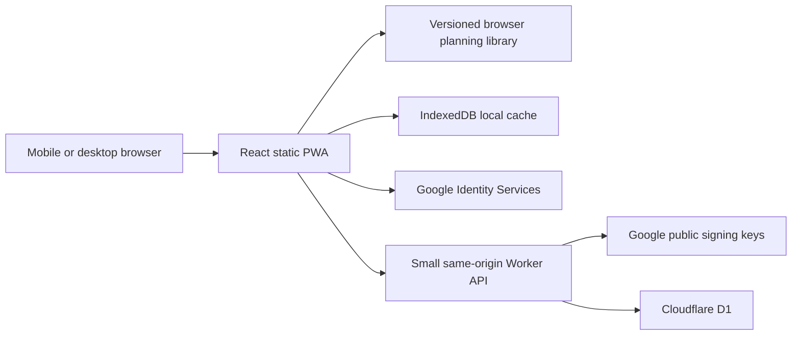

# Rephase system design

Status: local first implementation; deployment intentionally deferred. Last updated: 2026-10-14.

## Product and scope

Rephase helps travelers follow a personal light, sleep, caffeine, and optional melatonin schedule before, during, and after a trip. Its primary experience is a mobile daily agenda, with a dark, sleep-themed interface and an explicit current/next action. It is an independent implementation informed by published research, not a reproduction of Timeshifter's proprietary algorithm.

Confirmed requirements:

- Responsive web application with mobile navigation and desktop layouts.
- Google authentication, with no password management.
- Mostly static execution; Cloudflare Worker only for authenticated persistence and optional future integrations.
- Chronotype, usual and preferred bed/wake times, required sleep hours, caffeine and melatonin preferences.
- Complex itineraries with connections, multiple destination stays, and returns.
- Optional melatonin timing and evidence-based dose information.
- A working local preview before discussing Cloudflare deployment.

Implementation assumptions: manual flight entry initially, cross-device sync through a minimal Worker/D1 API, no paid flight-data provider, no push delivery, and an engineering MVP rather than a clinically validated medical product. These defaults can be revised without moving the planner to a server.

## Experience

Four main views:

1. **Today**: current and next action when a plan is active; upcoming preparation when the trip is in the future. Demo trips are clearly labeled. A future or completed trip must not masquerade as a current recommendation.
2. **Plan**: a date selector, named timezone, preparation/travel/stay stages, and chronological action cards with reasons. Sleep can cross midnight; start and end dates remain visible when needed.
3. **Trips**: create/edit/delete itineraries. Every flight has airport-local departure and arrival dates/times, timezone, optional flight number, connection/destination classification, and strategy for the following stay. Arrival time is entered separately, never inferred from route distance.
4. **Profile**: habitual sleep for baseline estimation, preferred sleep for target scheduling, duration and fixed-bed/fixed-wake anchor, chronotype, preparation days, optional supplements, and Google/sync controls.

The default example route includes London, a Dubai connection, Singapore, and a return to San Francisco. Example dates are relative to the current date; this is not live flight data. Editing an example creates a personal itinerary.

Color and icons reinforce written labels: violet sleep, amber light, muted blue light avoidance, mint caffeine, and rose melatonin. Use readable text at low brightness, 44px touch targets, keyboard focus, proper form labels, reduced motion, and layout without horizontal scrolling at 360px.

## Architecture

- **Frontend**: React, TypeScript, Vite, Lucide icons. Static HTML/CSS/JavaScript, with no SSR or runtime framework server.
- **Planner**: pure, deterministic TypeScript functions. No account or network dependency. The first engine uses conservative schedule rules. A calibrated numerical optimizer is a later, independently validated milestone.
- **Local data**: IndexedDB, partitioned by guest or Google account. Local changes survive reload; private API responses and authentication credentials are never put in the service-worker cache.
- **Offline**: a production-only service worker caches the static app shell and assets. Saved preferences/trips generate plans offline. Initial installation, Google sign-in, and sync need connectivity.
- **API**: one Worker serves `/api/*`; static assets handle the rest. D1 stores account state and hashed revocable sessions. Auth is optional for using the local planner.
- **Hosting**: Cloudflare Worker Static Assets. Wrangler configuration and D1 migrations are prepared locally, but no remote resource is created or deployed in this implementation turn.

## Domain model

`Preferences` holds home IANA timezone, chronotype, usual bedtime/wake time, preferred bedtime/wake time, `sleepHours`, `sleepAnchor`, supplement opt-ins, a melatonin suitability acknowledgement, and `preparationDays`.

`Trip` holds an ID, name, timestamps, and ordered `FlightLeg[]`. Each leg contains original local timestamps and explicit IANA zones, airport codes, optional flight number, `stayAfter` (`connection` or `destination`), and `strategy` (`adapt`, `partial`, `home`). Airport selection supplies a zone from a bundled common-airport catalog. An unlisted airport remains usable through explicit timezone input; the catalog is not claimed to cover every airport.

Each flight also records travel class (economy, premium economy, business, first) and a separately confirmed `lieFlat` flag. New user legs default to economy with no confirmed bed. These fields are optional for compatibility with older schema-1 records; missing bed availability receives conservative seated-rest guidance. Business/first labels never imply a bed. Airline/aircraft changes can alter seat availability, so the traveler confirms the actual seat.

The itinerary is interpreted as home → flights/connections → destination stay → flights/connections → next stay → return. Destination stays are derived from arrival and the next departure. A long layover is not automatically a destination stay: the traveler classifies it. Connections retain sleep opportunities and travel constraints without resetting the circadian baseline.

`Plan` contains engine version, input trip ID, generation timestamp, warnings, summary, and ordered `PlanDay[]`. Every action records a UTC start/end, named display zone, type, instructions, reason, and optional evidence/dose information. Plans are regenerated from inputs rather than synced as authoritative biological observations.

`AppData` has a schema version, preferences, trips, and selected trip ID. Local account namespaces are independent. Cloud state has an optimistic revision counter to prevent a stale device silently overwriting another device's changes.

## Time and validation

- Use Temporal with a polyfill to resolve local input to UTC.
- Reject nonexistent and repeated DST local times rather than silently picking an offset. A future UI enhancement can offer explicit repeated-time choices.
- Compare flights and connections in UTC; a date-line crossing can arrive on an earlier local calendar date.
- Validate timezones, required fields, positive elapsed durations, and departure ordering.
- Bound itinerary length/horizon and API payload size to prevent runaway work or storage.
- Preserve IANA zones and local timestamps so future timezone-rule changes can regenerate schedules.
- Include meaningful tests for DST transitions, half/quarter-hour offsets, date-line travel, overlapping flights, multi-stop continuity, and preference opt-outs.

## Science and first-engine limits

Light is the principal environmental cue for the central circadian clock. Its effect depends on estimated biological phase, not simply destination morning/evening. Melatonin timing for phase shifting differs from using it near bedtime for sleep. Caffeine supports alertness and can interfere with sleep; it is not a cure for circadian misalignment.

Initial phase is estimated from **habitual**, not preferred, sleep. Chronotype provides context, without adding an arbitrary extra morning/night-person offset on top of reported timing. Habitual sleep is still an imperfect phase estimate. A future seven-day diary or measured DLMO can improve the inputs, but even diaries do not establish precise biological phase.

The initial engine:

1. Resolves all legs to UTC and builds preparation, flight, connection, and destination periods.
2. Carries its estimated phase through the full itinerary, including the return.
3. Uses configurable preparation availability and conservative population-level shift assumptions, clearly labeled as assumptions.
4. Preserves requested sleep duration where feasible and avoids boarding/landing buffers. Unavoidable travel sleep loss is reported rather than hidden.
5. Generates light/avoidance windows around estimated biological phase and prevents overlap with scheduled sleep.
6. Supports full, partial, and home-time strategies. Short-stay goals may warrant partial adjustment.
7. Keeps caffeine windows at least eight hours away from scheduled sleep opportunities.
8. Emits uncertainty warnings for large shifts and excludes unsafe/uncertain melatonin timing.

Every in-flight rest opportunity starts no earlier than **30 minutes after takeoff** and ends no later than **60 minutes before landing**, irrespective of travel class or bed availability. A flight with no usable interval has no in-flight sleep action. Lie-flat availability changes opportunity wording and practical instructions; upright seating receives seated-rest/nap guidance without claiming a restorative full night. No unsupported class-specific phase rates or fixed 90-minute sleep cycles are introduced. Crew instructions always take priority.

The current calculation applies these margins to the entered flight departure/arrival interval. Airline timetables may use gate times rather than airborne times, so these are planned operational estimates: actual crew restrictions override the windows. The flight-provider milestone includes distinguishing gate and airborne timestamps and re-anchoring these buffers when actual takeoff/landing data is available.

**This is an evidence-informed rule engine, not a calibrated circadian oscillator or clinically validated intervention.** It cannot measure a user's phase, actual light exposure, sleep, or medication suitability. Do not present precise predicted recovery dates, guaranteed prevention, Timeshifter equivalence, or a guessed light window as an exact physiological measurement. Daylight feasibility is not yet computed from latitude/weather; advice explains when ordinary indoor light may be the available option.

Melatonin is disabled by default. Enable only after an acknowledgement explaining drowsiness, interaction review, and medical consultation where appropriate. Eligible action cards show **0.5–1 mg as general adult dose information** from current CDC guidance, not a personally optimized prescription. The first engine omits melatonin for large or phase-ambiguous shifts and around travel activities. It does not recommend waking to take it, morning sedation, increasing dose for larger shifts, or taking it before driving. Disabling the preference removes its actions entirely. Clinical suitability cannot be established by a checkbox; the copy says so.

Later research implementation: port and attribute an MIT-licensed published oscillator (e.g. Forger99/Jewett99/Hannay19 reference), compare numerical trajectories against the reference, optimize advance **and** delay routes, incorporate local daylight and realistic light/sleep constraints, then evaluate melatonin separately. The 2026 Huang itinerary model informs requirements but its authors' code is available on request, so the MVP does not claim to reproduce it. Research-model accuracy and real-world app efficacy require separate validation.

### Evidence references

- [CDC Yellow Book 2026 — Jet Lag Disorder](https://www.cdc.gov/yellow-book/hcp/travel-air-sea/jet-lag-disorder.html): clinical baseline for light, sleep, caffeine, short stays, and melatonin.
- [Khalsa et al. 2003 — Human light phase-response curve](https://pubmed.ncbi.nlm.nih.gov/12717008/): experimental phase-dependent light response.
- [Burgess et al. 2010 — Melatonin phase-response curves](https://pmc.ncbi.nlm.nih.gov/articles/PMC2928909/): dose-specific timing; laboratory results are not daily adjustment rates.
- [Reiter et al. 2020 — Estimation of DLMO from sleep markers](https://pubmed.ncbi.nlm.nih.gov/32894981/): habitual sleep markers do not precisely measure phase.
- [Christensen et al. 2020 — Practical circadian schedule optimization](https://journals.plos.org/ploscompbiol/article?id=10.1371/journal.pcbi.1008445): real-world constraints and adherence.
- [Huang et al. 2026 — Modeling itinerary effects on jetlag duration](https://doi.org/10.1093/sleep/zsag063): flight timing and sleep opportunities affect simulated adaptation; group-average modeling, not a personalized efficacy trial.
- [Drake et al. 2013 — Caffeine and sleep](https://pubmed.ncbi.nlm.nih.gov/24235903/) and [Burke et al. 2015 — Caffeine and circadian timing](https://pubmed.ncbi.nlm.nih.gov/26378246/).
- [NCCIH — Melatonin](https://www.nccih.nih.gov/health/melatonin-what-you-need-to-know): interactions and special-population consultation.
- [Arcascope circadian reference models](https://github.com/Arcascope/circadian): potential later numerical reference, MIT license.

## Authentication and persistence

Google Identity Services supplies an ID token; merely decoding it in the browser does not authorize cloud data. The Worker issues a short-lived challenge, binds it to an HttpOnly cookie, and verifies Google's signature/JWKS, issuer, audience, expiration, and challenge nonce. Use Google `sub` as the stable account ID.

Issue an opaque session cookie with HttpOnly, SameSite, HTTPS Secure, and expiry. Only hashed session tokens are stored in D1. Revoke on sign-out. Production requests remain same-origin; local Vite proxying has an explicit permitted localhost origin. Every database operation derives ownership from the verified session, not a browser-supplied user ID. Limit bodies and validate schema. Check Origin on mutations and bind login to a one-use challenge. Never log tokens or store them in localStorage.

API contracts:

| Method/path | Result |
| --- | --- |
| `GET /api/config` | Public Google client ID or null, sync availability |
| `GET /api/auth/challenge` | Login nonce and challenge cookie |
| `POST /api/auth/google` | Verify `{credential}`, establish session, return account |
| `GET /api/me` | Current account or 401 |
| `POST /api/auth/logout` | Revoke session and expire cookie |
| `GET /api/state` | `{data, revision}` for session owner |
| `PUT /api/state` | Save `{data, revision}`; stale revision returns 409 |
| `DELETE /api/state` | Delete saved cloud preferences/trips |

Local use works without credentials. Google/sync controls explain when configuration is unavailable; there is no fake sign-in. First sign-in requires an explicit choice to copy guest data to an account; downloaded cloud state never silently overwrites an edited guest itinerary. Revision conflicts offer fetch-cloud or keep-local choices. Sync is explicit in the first version; automatic background merging is deferred.

State requests include an expected-account header, which the Worker compares with the verified session identity. The header never selects database ownership. This rejects a stale tab's request when another tab has switched the shared session to a different Google account. Client account operations are serialized; revisions remain bound to the account namespace across reload.

D1 migrations define users, sessions/challenges, and user state. This keeps the API small while retaining schema/revision metadata. Future per-trip records can replace the aggregate state when concurrent editing warrants it.

Local logout switches to the guest namespace. Account-local data can be explicitly cleared. JSON export remains available. Delete-cloud-data is distinct from deleting the local copy and must clearly describe its result. Deletion retains only a monotonic revision tombstone so an old client cannot overwrite a recreated cloud record.

An offline namespace pointer stores only the last account's local display identity, never a token. It lets that account's saved data reopen offline, but it does not authorize an API operation. The Worker still verifies sessions on every account request; online mutations require an account match.

## Offline and exports

Production service-worker caching is restricted to same-origin static GET requests. `/api/*` and Google requests are excluded. Cache versioning replaces the old shell safely; dev mode does not install a worker, avoiding stale hot-reload code.

Calendar export produces RFC 5545 `.ics` events with UTC instants, escaped content, and stable event IDs. Contiguous midnight-split actions are merged before export so a sleep continuation cannot trigger an additional bedtime alarm. Calendar reminders may work offline after import, but alarm behavior varies by calendar application. Rephase does not request Google Calendar access. There is no reliable browser timer for a closed mobile app; Web Push, subscriptions, and scheduled delivery would require a later backend feature.

DM Sans and Manrope are bundled locally with their SIL Open Font Licenses. Typography remains available offline and does not require external font requests.

## Development and deployment boundary

Local static preview: `npm install`, `npm run dev`, then `http://localhost:5173`. Without the API, trip/profile/planning/export work and sign-in shows configuration status.

Local full stack: build assets, initialize local D1, run Wrangler on 8787, and run Vite on 5173. A Google OAuth web client ID and registered localhost JavaScript origin enable real sign-in; no OAuth client secret is required for this GIS flow. `.dev.vars` is ignored. No Google credentials are supplied in this repository.

Before Cloudflare deployment, select an account/domain, create a D1 database, replace the local database ID, apply remote migrations, configure the Google client ID/production origin, build, and then deploy. These are future actions for discussion with the user, not actions taken during local implementation.

Primary platform documentation: [Cloudflare Static Assets](https://developers.cloudflare.com/workers/static-assets/), [SPA routing](https://developers.cloudflare.com/workers/static-assets/routing/single-page-application/), [D1](https://developers.cloudflare.com/d1/), [Google token verification](https://developers.google.com/identity/gsi/web/guides/verify-google-id-token), and [Google OAuth client setup](https://developers.google.com/identity/gsi/web/guides/get-google-api-clientid).

### Planned dynamic flight lookup and caching

The requested integration looks up airline/flight number and the **departure-airport local date**, returning departure/arrival airports, scheduled local times, offsets, duration, and airline. This is roadmap work, not an implemented live integration. After current-provider research, **AeroDataBox is the recommended candidate for evaluation**; Amadeus is retained below as historical context rather than the active default.

**Current access dependency:** as verified on 2026-10-14, Amadeus's official portal states its Self-Service portal was decommissioned on July 17; its official API specification repositories were archived on July 17, 2026. The historic Self-Service free tier is not assumed to be available. Confirm current Amadeus Enterprise access and terms, or discuss a supported provider before implementation. [Official portal notice](https://admin.developers.amadeus.com/), [official archived specifications](https://github.com/amadeus4dev/amadeus-open-api-specification).

The historical REST operation was `GET /v2/schedule/flights`, with `carrierCode`, `flightNumber`, `scheduledDepartureDate`, and optional `operationalSuffix`. Its leg board/off-point IATA codes and matching `STD`/`STA` timing records provide schedule data; duration comes from scheduled-leg/segment duration. Codeshare operating carriers and multi-leg flight numbers need explicit candidate selection. Airline names require a carrier dictionary. Returned offsets must be joined to airport IANA zones; an offset alone cannot identify a timezone. Historical sandbox data was a snapshot, so coverage and future-date availability must be checked against the eventual account. [Historical official OpenAPI contract](https://github.com/amadeus4dev/amadeus-open-api-specification/blob/main/spec/yaml/OnDemandFlightStatus_v2_swagger_specification.yaml).

Implement a Worker provider adapter and normalized flight-candidate schema. Credentials and provider access tokens remain in Worker secrets/memory, never client assets. Resolve airport zones, validate durations and chronology in UTC, and ask the traveler to confirm editable results before changing the itinerary. Travel class/actual bed availability remain user inputs; a generic flight-status response cannot establish them.

Cache permitted normalized schedules in D1 by provider, environment, schema version, carrier, flight number/suffix, and local departure date. Include fetch/expiry timestamps and source attribution. Use provider-approved TTLs: longer for distant schedules, shorter near departure, plus brief negative-result caching. Deduplicate concurrent lookups, cap requests/pagination, enforce user-level usage limits, and respect licensing/quotas. Display stale results explicitly when refresh fails; keep manual entry available and never fabricate missing schedule data.

Provider comparison verified on 2026-10-14:

| Provider | Suitability for a known flight months ahead |
| --- | --- |
| AirLabs | Official schedules cover at most about 10 hours ahead; its single-flight endpoint returns the nearest occurrence, not a specified future date. [Schedules](https://airlabs.co/docs/schedules), [single flight](https://airlabs.co/docs/flight). |
| Skyscanner | Route/date booking search, with partner approval and booking-use requirements; its FAQ explicitly excludes a specific-flight search. [Official FAQ](https://developers.skyscanner.net/docs/faqs). |
| AeroDataBox | Direct flight-number/date lookup using `dateLocalRole=Departure`. Free RapidAPI Basic for noncommercial testing; Pro is a low-cost commercial option. Future coverage is best effort. [Date semantics](https://aerodatabox.com/flight-history/), [coverage](https://aerodatabox.com/data-coverage/). |

The AeroDataBox RapidAPI listing shows Basic at $0 with 400 units/month and a maximum ±365-day data range; Pro at $8/month with 5,000 units and a ±180-day range. Single-date flight lookup consumes two units. These are plan ceilings, not guarantees that any given future flight exists in the dataset. Confirm route coverage and current terms before enabling live integration. [Provider pricing](https://rapidapi.com/aedbx-aedbx/api/aerodatabox/pricing).

Its current terms distinguish a shared cache (normally at most seven days) from genuine owner-specific trip records: Article 5.8 allows limited booked/traveled-trip fields while that owner keeps the record. Owner records must not supply a shared lookup cache, and incorporated data follows owner deletion. Attribution and noncommercial restrictions apply to the free plan. [Current terms](https://aerodatabox.com/terms). Keep provider credentials server-side and validate sample +60/+90/+150-day routes before adoption.

### Tooling evaluation

The verified development workflow currently uses Node/npm, Vite, Vitest, Playwright, and Wrangler. Bun can offer faster installs and script execution, but the deployed browser and Cloudflare runtimes remain independent of that choice. Evaluate Bun on reproducible installs, native dependency lifecycle scripts, Wrangler, and the existing tests before adopting a single authoritative lockfile. Replacing the Vite bundler or test framework is a separate decision with a smaller likely benefit for this static app. [Bun package manager](https://bun.com/docs/pm/cli/install), [Bun compatibility status](https://bun.com/docs/runtime/nodejs-compat).

## Verification and known future work

Require TypeScript checks, a production build, temporal/itinerary/opt-out tests, Worker rejection/ownership/revision tests, and local HTTP smoke checks. Browser QA is run only when a supported browser-control tool is available; otherwise disclose that visual interactions have not been browser-tested. Real Google sign-in cannot be end-to-end verified without an OAuth client. No deployment or clinical validation is implied by passing engineering checks.

See [TODO.md](TODO.md) for completed work, remaining implementation tasks, and research/deployment milestones.
