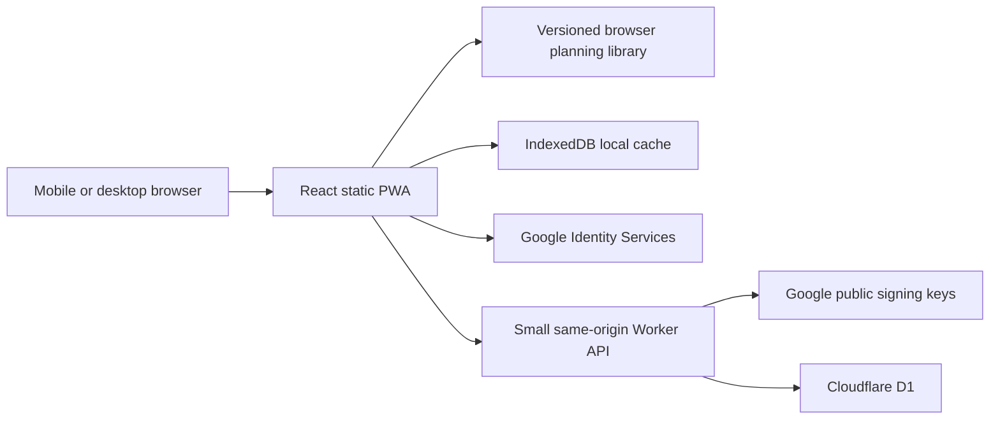

# Rephase system design

Status: deployed at https://rephase.surtani.org. Last updated: 2026-10-15.

## Product and scope

Rephase helps travelers follow a personal light, sleep, caffeine, and optional melatonin schedule before, during, and after a trip. Its primary experience is a mobile daily agenda, with a dark, sleep-themed interface and an explicit current/next action. It is an independent implementation informed by published research, not a reproduction of Timeshifter's proprietary algorithm.

Confirmed requirements:

- Responsive web application with mobile navigation and desktop layouts.
- Google authentication, with no password management.
- Mostly static execution; Cloudflare Worker only for authentication, automatic signed-in account persistence, and optional flight-provider lookup. Guest planning remains device-only.
- Chronotype, usual and preferred bed/wake times, required sleep hours, caffeine and melatonin preferences.
- Complex itineraries with connections, multiple destination stays, and returns.
- Optional melatonin timing and evidence-based dose information.
- A working local preview before discussing Cloudflare deployment.

Implementation choices: manual entry with optional AeroDataBox lookup, a minimal Worker/D1 API, server-authoritative signed-in accounts with automatic saving, a browser planning worker, and calendar reminders rather than Web Push. Provider access and real Google login require user configuration. This is an engineering implementation with numerical reference checks, not a clinically validated medical product.

## Experience

Five main views:

1. **Today**: current and next action when a plan is active; upcoming preparation when the trip is in the future. Demo trips are clearly labeled. A future or completed trip must not masquerade as a current recommendation.
2. **Plan**: one airplane-window tile per calendar date, named timezones, preparation/travel/stay stages, and chronological action cards with reasons. Amber plane markers identify every flight day, including short flights with no usable rest window. Flight cards and travel-day recommendations show both origin and destination clocks with explicit local dates and timezone labels. Flight facts appear separately from recommendations; aircraft and both departure/arrival clocks are initially collapsed under Flight details, independently of Meal times & details. A quiet Lounge Explorer link sits before each departure card; sleep can cross midnight.
3. **Trips**: create/edit/delete itineraries. The default flight editor shows flight number and departure date with lookup/confirmation. A selected or existing leg shows its route summary and retains travel class/lie-flat choices. Airports, local departure/arrival date-times and zones remain hidden until **Enter manually** is chosen, including for existing legs. Changing the lookup query invalidates its confirmation; saving requires a newly confirmed result or an explicit manual-entry choice. Changing Google accounts closes any open trip draft and guards saving against a different account identity. Each leg also records connection/destination classification and strategy for the following stay. Native date/time controls are constrained to their field widths, including WebKit intrinsic value sizing on mobile. Manual time inputs use HH:mm. A blank arrival initially follows departure until edited; an existing/imported arrival remains intact. This is an editable wall-clock starting point, never a calculated schedule or an inference from route distance.
4. **Lounges**: a local Lounge Explorer searches curated airport records and compares access, airport-local opening windows and amenities against saved memberships, the departing flight and personal priorities. Flight links prefill the departure airport and known flight/cabin context. A conservative visit window is supplied where possible; limited connections retain their actual remaining time, while unavailable/unknown windows start blank. Missing operating-carrier or terminal facts remain conditional. Saved memberships appear as a read-only summary with an Edit memberships shortcut to Profile.
5. **Profile**: habitual sleep for baseline estimation, preferred sleep for target scheduling, duration and fixed-bed/fixed-wake anchor, chronotype, preparation days, optional supplements, lounge memberships/airline loyalty status, and data export/deletion controls. The header shows Google sign-in when signed out and the Google avatar with a Sign out menu when signed in.

The default example route includes London, a Dubai connection, Singapore, and a return to San Francisco. Example dates are relative to the current date; this is not live flight data. Editing an example creates a personal itinerary.

Color and icons reinforce written labels: violet sleep, amber light, muted blue light avoidance, mint caffeine, and rose melatonin. Use readable text at low brightness, 44px touch targets, keyboard focus, proper form labels, reduced motion, and layout without horizontal scrolling at 360px.

## Lounge Explorer and offline research

Lounge discovery runs entirely in the browser. No lounge API, secret, D1 table or scheduled job is required. Curated airport JSON is bundled and included in the offline shell; changes use the existing verified release workflow. The first dataset contains 16 selected lounges at SFO, SYD, HNL and LAX, researched from official airline/operator/airport/program pages on 15 October 2026. Coverage is deliberately incomplete and is shown as such, including unsupported airports and memberships.

**Data contract.** Keep one file per airport under `data/lounges/`, with `schemaVersion`, airport code, IANA timezone, review date and a list of stable lounge IDs. [schema.json](data/lounges/schema.json) defines the editable contract; [the research guide](data/lounges/README.md) describes provenance, examples and updates. Each lounge includes terminal/location, airside status, operational closure, weekly/overnight opening periods and dated exceptions, tri-state amenities, access alternatives, sources and photos. Missing amenities remain unknown. Distinguish restaurant, buffet, snacks and no food. Optional `recommendation.summary` and `recommendation.bestFor` hold offline editorial research without invented ratings.

**Access and recommendations.** Access rules are OR alternatives, with populated fields inside each rule combined by AND. Match specific membership/status, cabin, operating and marketing carrier/alliance, route/country and entry/stay limits. Qantas Platinum implies oneworld Emerald; paid Qantas Club is separate. Both marketing and operating carriers must qualify for oneworld access. A flight-number prefix identifies a marketing hint; the operator must be confirmed in Explorer. Generic alliance status, restricted fares and unencoded conditions stay conditional. A domestic US premium cabin alone never establishes international-style lounge access. Mandatory extra entry fees are structured independently of visit fees or amenity extras; use only the selected access route's fee when displaying a recommendation.

Expand opening hours in the airport timezone using real UTC intervals, accounting for overnight periods, DST and date overrides. Clip the longest useful opening to the visit, permitted entry time and maximum stay. Closed lounges, missing hours and insufficient usable time cannot be recommended. Unconfirmed/different terminals require a transfer check; this version does not calculate walking routes, gate assignments or security queues. Research older than 180 days requires review. Among confirmed, open, usable matches, rank known showers/dining/quiet amenities and the traveler's priority, with a small boost for researched `bestFor` tags. Explain the choice and expose linked access sources. A matching rule concerns the individual traveler, not guaranteed capacity, included guests or complimentary spa/dining privileges.

**Planner links.** Compute opportunities separately from the circadian model. Pre-flight windows assume airport arrival 180 minutes before international/unknown routes and 120 before domestic routes; leave 45/30 minutes before departure. Explicit same-airport transits reserve 60 minutes for international/unknown arrival formalities, or 30 for domestic arrivals, plus the departing-flight buffer. Require at least 60 usable minutes, suppress cross-airport transfers, invalid/overlapping itineraries and connections exceeding 12 hours, and clamp short destination stays to the actual prior arrival. These are adjustable assumptions, not measured airport arrival or guaranteed clearance times. Every valid departure gets a compact link before its flight card, including unresearched airports. Short same-airport connections retain their actual remaining minutes; overlapping buffers, unknown transfers and uncertain timing get no fabricated visit. Links appear on the local departure date, not later in-flight/arrival continuation days. The Explorer initially requires operating-airline confirmation and can be used independently for any airport, with a clear no-coverage result.

**Saved preferences.** Schema-1 preferences accept optional bounded `loungeMemberships` and `loungePriority`; old accounts/imports remain valid. Membership/status changes are committed with Profile’s Save preferences button, then use existing automatic D1 saves and offline account cache. Explorer displays the saved programs and keeps the amenity-priority selector; guest preferences stay on the device. Flight context is ephemeral and resets on account/trip changes. Lounge-only preference edits do not restart circadian calculations. Shared browser/Worker validation and normal three-way merge behavior apply; no migration or additional storage service is needed.

**Photos.** Keep optimized files at `public/lounges/<lounge-id>/` and reference `/lounges/...` paths from JSON, with alt text, photographer credit, license and original source URL. Only use owner-supplied or explicitly licensed photos; starter records have empty arrays. Images are served as static assets and available offline after precaching. Data tests validate schema, IDs, references, real dates/timezones, carrier prerequisites and safe existing image files. UI cards use a calm icon fallback when images are absent.

## Architecture

- **Frontend**: React, TypeScript, Vite, Lucide icons. Static HTML/CSS/JavaScript, with no SSR or runtime framework server.
- **Planner**: pure TypeScript functions executed in a dedicated browser Web Worker; obsolete requests are cancelled. No account or network dependency. The default experimental model ports published Forger99 dynamics and searches constrained advance/delay schedules. A conservative rules mode remains selectable.
- **Data ownership**: D1 is authoritative for verified signed-in accounts. IndexedDB provides a separate guest store and account-isolated offline caches with explicit pending edits and merge baselines. A legacy account copy can be shown offline but cannot replace existing server state or a deletion tombstone. Private API responses and authentication credentials are never put in the service-worker cache.
- **Offline**: a production-only service worker caches the static app shell and assets. Saved preferences/trips generate plans offline. Initial installation, Google sign-in, and account reads/writes need connectivity. Cached plans and explicitly pending edits remain usable offline.
- **API**: one Worker serves `/api/*`; static assets handle the rest. D1 stores account state, hashed revocable sessions, provider cache and request quotas. Auth is optional for local planning and required for provider lookup. An hourly scheduled handler purges expired provider cache.
- **Hosting**: Cloudflare Worker Static Assets. The app is deployed at https://rephase.surtani.org with D1 migrations applied and a Custom Domain managing DNS/TLS. GitHub Actions supports manual deployment and automatic main-branch deployment when the repository variable `DEPLOY_ENABLED=true`.

## Domain model

`Preferences` holds home IANA timezone, chronotype, usual bedtime/wake time, preferred bedtime/wake time, `sleepHours`, `sleepAnchor`, supplement opt-ins, `preparationDays`, a stored planning mode and the calendar-alarm preference. The obsolete `melatoninAcknowledged` and `autoSync` fields remain readable for saved-data compatibility and no longer control behavior. The melatonin toggle is the sole opt-in. The planner-selection dropdown is omitted from everyday preferences: new accounts use the published circadian model, while an existing saved rules-mode choice remains intact. Saving signed-in edits is automatic.

The home timezone field is an accessible local autocomplete over browser-supported IANA zones, bundled airport cities/zones and UTC. It filters as the traveler types, caps suggestions, supports keyboard and touch selection and keeps valid manual aliases unchanged unless the traveler explicitly chooses a canonical suggestion. It works offline and falls back to bundled airport zones if the browser lacks `Intl.supportedValuesOf`; parent form validation rejects invalid free text. Flight timezone fields retain their existing manual controls.

The plan's body-clock card shows only the estimated daily change, remaining adjustment and the selected estimate's city. Unavailable daily history receives a short explanation and no invented remaining value. Long internal model notes are omitted from this card; a single Science link provides the calculation details. The adjacent **Light tips** card gives practical light advice.

`Trip` holds an ID, name, timestamps, and ordered `FlightLeg[]`. Each leg contains original local timestamps and explicit IANA zones, airport codes, optional flight number, `stayAfter` (`connection` or `destination`), and `strategy` (`adapt`, `partial`, `home`). Airport selection supplies zones and coordinates from a pinned MIT global catalog of 7,884 IATA airports. Manual codes/zones remain supported for unlisted or ICAO airports. Suggestions are filtered and capped so the editor does not render thousands of DOM options. See DATA_SOURCES.md for provenance, update checks, and license.

Each flight also records travel class (economy, premium economy, business, first) and a separately confirmed `lieFlat` flag. New user legs default to economy with no confirmed bed. These fields are optional for compatibility with older schema-1 records; missing bed availability receives conservative seated-rest guidance. Business/first labels never imply a bed. Airline/aircraft changes can alter seat availability, so the traveler confirms the actual seat.

Legs also support explicit DST-fold occurrence choices, optional local airborne timestamps, and default taxi allowances. Selecting **Use this flight** applies a lookup result directly, without a separate checkbox. Provider provenance/fetch time and the existing selection-confirmation flag persist on imported legs; a later manual edit does not erase provenance or imply a reverified provider schedule. One provider hyperlink appears in the site footer rather than in flight forms or on individual trip cards. The link uses `noopener` without `noreferrer`, allowing normal referral information under the [provider's free-plan attribution terms](https://aerodatabox.com/terms).

Flight editing uses the labels **Final Destination**, **Transit** and **Adjustment Strategy**. Both engines label ground/lie-flat sleep actions **Bedtime** and seated-flight actions **Rest or nap**. Guidance gives concise practical instructions and the 30/60-minute airborne boundaries; repeated booking, taxi and crew reminders are omitted from the normal flight flow. Full model assumptions and scientific limitations remain on the Science page.

`AdherenceRecord` stores the original action ID/type, scheduled UTC interval and display zone, completed/missed/partial status, optional actual UTC interval, and recording time. Light/sleep records replay past assumed exposure in model mode; caffeine and melatonin records are a diary. They are not physiological measurements.

The itinerary is interpreted as home → flights/connections → destination stay → flights/connections → next stay → return. Destination stays are derived from arrival and the next departure. A long layover is not automatically a destination stay: the traveler classifies it. Connections retain sleep opportunities and travel constraints without resetting the circadian baseline.

`Plan` contains engine version, input trip ID, generation timestamp, warnings, summary, and ordered `PlanDay[]`. Every action records a UTC start/end, named display zone, type, instructions, reason, and optional evidence/dose information. Plans are regenerated from inputs rather than synced as authoritative biological observations.

Planner place names come from the itinerary airport's city in the bundled catalog, independently of the IANA zone used to calculate time. Each generated day carries its location airport; date tiles, stay/connection headings, Today and clock/estimate captions resolve that city. For example, a stay after arriving at SFO displays **San Francisco** while retaining `America/Los_Angeles` and the appropriate PDT/PST clock. A subsequent LAX stay can display Los Angeles without requiring a timezone change. Unknown airport cities use neutral place descriptions, rather than inventing a city from the timezone name or presenting an airport code as a city. Existing saved trips regenerate these labels without a schema migration or provider call.

A shared post-processing step adds `PlanTravelSegment` gate-to-gate UTC intervals and both airport zones after either engine runs. Calendar overlap uses actual zoned midnight boundaries, including 23/25-hour DST days. Departure-origin, arrival-destination, and intervening destination dates remain visible even when there are no recommendation actions. Multiple flights on the same day retain separate cards. The presentation groups zoned source days by their local date label, deduplicates flight/action IDs, and keeps all action UTC intervals and original clocks. One valid source estimate is chosen and its timezone labeled; overlapping estimates are never added. Today checks every source clock, so choosing a destination estimate does not hide an origin date already underway. Schedule-only days have no invented actions or phase estimate, and create no extra medical calendar events. Today considers active/upcoming flights as well as recommendation windows.

`AppData` has a schema version, preferences, trips, and selected trip ID. Local account namespaces are independent. Cloud state has an optimistic revision counter to prevent a stale device silently overwriting another device's changes.

### Daily visual timeline

The Plan view renders each calendar-date tile as a vertical timeline instead of separate flight and recommendation lists. One UTC-ordered rail carries concurrent bands for sleep/rest, light/darkness, caffeine, melatonin and flights, with free time filling intervals without scheduled sleep/rest. Free time is a presentation gap rather than a measured awake state or an instruction to stay awake. The axis shows the actual local date and timezone at each boundary; DST folds never reverse UTC order. Date-line days retain source-clock intervals even if they extend beyond midnight in the representative clock. Existing action IDs, intervals, physiology, logging and calendar exports are unchanged.

Inline cards appear at their start boundary, retain both airport clocks on travel days and show the interval duration and end time. Timeline rows follow actual activity/band changes, local midnight and timezone-offset transitions, rather than decorative hourly ticks. Unchanged spans of two hours or longer compress to a short continuous band with an ellipsis, preserving actual start/end clocks and elapsed duration. Ongoing Flight/Sleep labels are not repeated; a quiet free-time span receives one label. Rows expand only to fit readable cards and opened details, so the rail does not claim a fixed pixels-per-hour scale. Explanations and adherence controls remain on recommendations. Flight cards show departure/arrival times and aircraft, omit gate assignments/wording, keep meal advice visible and let travelers expand meal times/details in the timeline. Today retains its compact existing cards.

### Meals around planned sleep

A separate deterministic post-processing step adds a `FlightMealPlan` to each flight's generated metadata. Flights with planned in-flight sleep/rest recommend asking the crew not to wake the traveler for meals. Other flights allow meal service while awake. Flexible before-flight, in-flight, and after-arrival windows fit around all planned sleep, operational exclusion periods, other legs, and transfer buffers. Recorded missed sleep is excluded; recorded actual sleep bounds replace scheduled history, and uncertain partial records retain an explicitly uncertain buffer. Calendar export uses the same effective-sleep resolver. Meals do not modify sleep recommendations or simulate a physiological food effect. Actual airline service and food availability remain unknown. With insufficient awake time, the app explains that no practical window fits instead of inventing one or recommending fasting.

Meal windows show both airport clocks, are deduplicated in calendar exports, and never create meal alarms. The static Science page links CDC destination-time guidance, NHLBI healthy-sleep advice, and small human metabolic studies; these do not establish that fasting or precise meal timing treats jet lag.

## Time and validation

- Use Temporal with a polyfill to resolve local input to UTC.
- Reject nonexistent DST clocks. Repeated clocks require an explicit earlier/later occurrence; the editor shows both UTC instants. Provider UTC offsets determine the correct occurrence for imported schedules.
- Compare flights and connections in UTC; a date-line crossing can arrive on an earlier local calendar date.
- Validate timezones, required fields, positive elapsed durations, and departure ordering.
- Bound itinerary length/horizon and API payload size to prevent runaway work or storage.
- Preserve IANA zones and local timestamps so future timezone-rule changes can regenerate schedules. Minute-resolution editor presentation does not truncate unedited provider seconds, including known airborne times used for operational exclusions.
- Include meaningful tests for DST transitions, half/quarter-hour offsets, date-line travel, overlapping flights, multi-stop continuity, and preference opt-outs.

## Science, model, and limits

Light is the principal environmental cue for the central circadian clock. Its effect depends on biological phase, rather than simply destination morning/evening. Melatonin timing for phase shifting differs from using it near bedtime for sleep. Caffeine supports alertness and can interfere with sleep; it is not a cure for circadian misalignment.

Initial phase is estimated from **habitual**, not preferred, sleep. Chronotype provides context, without adding an arbitrary offset on top of reported timing. Neither reported sleep nor a chronotype answer measures DLMO. The standalone `/science.html` page explains these concepts without JavaScript and links authoritative guidance and original research.

### Published numerical model

The Forger99 right-hand side and fixed parameters are ported from the MIT-licensed Arcascope reference at pinned commit `db6eb08b6c0b0586cdac7795bf10bbbbfd323c1a`. RK4 integration uses a five-minute final replay; candidate search uses fifteen minutes. An independent Python generator imports the upstream derivatives and compares adaptive SciPy DOP853 and upstream RK4 trajectories across darkness, habitual entrainment, variable light, and high-light pulses. Step-size convergence and model minima are tested separately. Attribution, reproduction instructions, and actual tolerances appear in `THIRD_PARTY_NOTICES.md`, `src/lib/circadian/README.md`, and committed fixtures. **These checks verify equations and computation, not personal phase estimates or clinical outcomes.**

The planner initializes a habitual light/dark routine for 21 days with fixed published parameters. Reported usual bedtime and wake time determine the baseline duration separately from desired future sleep; unsupported baseline durations fall back explicitly with a warning. It compares constrained advance and delay candidates at adapting stays, retaining a beam of three whole-itinerary routes and carrying oscillator state through every connection/destination/return. Modeled oscillator minima guide light windows and phase-error scoring; a preferred-routine oscillator establishes the target. The search is bounded, approximate, and not claimed to find a global optimum. Planned main sleep changes are limited to one hour per day where unconstrained, with requested elapsed duration preserved when travel allows.

Model inputs assume darkness 0 lux, dim light 10 lux, waking background 150 lux, bright indoor light 500 lux, and daylight opportunity 1,000 lux. Airport coordinates estimate sunrise/sunset, including polar day/night. Daylight does not guarantee sunshine or actual received light. Unknown locations and nighttime windows identify an indoor/uncertain light requirement. Seat class, sleep quality, fatigue, caffeine, and melatonin do not drive this light-only physiology model.

Baseline sensitivity replays begin two hours earlier and later. This is an illustrative uncertainty check, not a confidence interval or individualized calibration. No promised recovery date or guaranteed jet-lag prevention is shown. Health conditions, individual responses, observed exposure, and real adherence can change outcomes.

Past light/sleep records replay assumed exposure and constrain darkness, then recommendations are generated only for the future. Logged scheduled history remains visible; a new calculation does not rewrite recorded actions. Missed/partial records and unlogged time need assumptions. Actual sleep is not measured, and the model does not calculate sleep debt or a cabin-specific adaptation rate. A dedicated Web Worker keeps searching off the UI thread; longer bounded itineraries can take several seconds.

Daily model change uses successive biological low points from the selected route's existing five-minute numerical replay, with positive values meaning earlier and negative values later. The previous display compared a forecast of a low point to that same upcoming low and frequently showed a misleading zero. Days without an unambiguous pair and matching model coverage are unavailable. Small changes remain in data and are displayed approximately in minutes or hours, rather than rounded to 0.0. This display repair does not change route scoring or generated action times. Detailed model disclosure lives on the Science page instead of a repeated daily box.

### Operational constraints and optional tools

In-flight rest starts at least **30 minutes after takeoff** and ends at least **60 minutes before landing**, regardless of cabin class. Known airborne timestamps override estimates. Gate-only schedules allow **30 minutes taxi-out and 30 minutes taxi-in by default**, with editable allowances, then apply airborne buffers. Invalid explicit airborne ordering is rejected; short flights without usable rest have no sleep action. Connection/boarding/arrival transitions are also protected. Lie-flat availability changes comfort instructions, not model dynamics. Seated travel receives rest/nap guidance without claiming a restorative full night. Crew instructions always take priority.

Caffeine windows are optional and stay at least eight hours from planned sleep. This is a conservative practical cutoff, not a guarantee for all doses or individuals. The model does not simulate caffeine's alertness or phase effects.

Melatonin is disabled by default and enabled with one preference toggle, without a warning panel or separate acknowledgement. Eligible cards show **0.5–1 mg as general adult CDC information**, not an optimized personal prescription. Guidance is constrained to ground nighttime sleep with conservative biological-phase and advance-route checks; large or uncertain shifts and travel/transfer windows omit it. The numerical model does not simulate melatonin or optimize dose. The Science page retains suitability and source information. Do not wake solely to take it or treat it as safe before driving/working.

### Conservative rules mode and research boundary

Rules mode retains the original evidence-informed planner with clearly labeled population shift assumptions, whole-trip continuity, and large-shift uncertainty exclusions. Its linear adjustment assumptions are not claimed as measured physiology. Adherence-driven numerical replanning belongs to model mode.

The 2026 Huang itinerary model informs requirements, but its authors' code is available on request; Rephase does not claim to reproduce it or Timeshifter's proprietary algorithm. Clinical review of supplement guidance, usability evaluation, and real-world efficacy assessment remain separate research gates. Engineering completion cannot substitute for them.

### Evidence references

- [CDC Yellow Book 2026 — Jet Lag Disorder](https://www.cdc.gov/yellow-book/hcp/travel-air-sea/jet-lag-disorder.html): clinical baseline for light, sleep, caffeine, short stays, and melatonin.
- [Khalsa et al. 2003 — Human light phase-response curve](https://pubmed.ncbi.nlm.nih.gov/12717008/): experimental phase-dependent light response.
- [Burgess et al. 2010 — Melatonin phase-response curves](https://pmc.ncbi.nlm.nih.gov/articles/PMC2928909/): dose-specific timing; laboratory results are not daily adjustment rates.
- [Reiter et al. 2020 — Estimation of DLMO from sleep markers](https://pubmed.ncbi.nlm.nih.gov/32894981/): habitual sleep markers do not precisely measure phase.
- [Christensen et al. 2020 — Practical circadian schedule optimization](https://journals.plos.org/ploscompbiol/article?id=10.1371/journal.pcbi.1008445): real-world constraints and adherence.
- [Huang et al. 2026 — Modeling itinerary effects on jetlag duration](https://doi.org/10.1093/sleep/zsag063): flight timing and sleep opportunities affect simulated adaptation; group-average modeling, not a personalized efficacy trial.
- [Drake et al. 2013 — Caffeine and sleep](https://pubmed.ncbi.nlm.nih.gov/24235903/) and [Burke et al. 2015 — Caffeine and circadian timing](https://pubmed.ncbi.nlm.nih.gov/26378246/).
- [NCCIH — Melatonin](https://www.nccih.nih.gov/health/melatonin-what-you-need-to-know): interactions and special-population consultation.
- [Arcascope circadian reference models](https://github.com/Arcascope/circadian): pinned numerical reference used by the Forger99 port, MIT license.

## Authentication and persistence

Google Identity Services supplies an ID token; merely decoding it in the browser does not authorize cloud data. The Worker issues a short-lived challenge, binds it to an HttpOnly cookie, and verifies Google's signature/JWKS, issuer, audience, expiration, and challenge nonce. It renews an unused challenge without changing its nonce, and the browser serializes challenge acquisition with Web Locks when supported, so another tab preparing sign-in does not invalidate an open Google popup. The challenge remains one-use. Use Google `sub` as the stable account ID.

Issue an opaque session cookie with HttpOnly, SameSite, HTTPS Secure, and expiry. Only hashed session tokens are stored in D1. Revoke on sign-out. Production requests remain same-origin; local Vite proxying has an explicit permitted localhost origin. Every database operation derives ownership from the verified session, not a browser-supplied user ID. Limit bodies and validate schema. Check Origin on mutations and bind login to a one-use challenge. Never log tokens or store them in localStorage.

API contracts:

| Method/path | Result |
| --- | --- |
| `GET /api/config` | Public Google client ID or null, account-storage and flight-lookup availability/provider (`syncAvailable` remains the API field name) |
| `GET /api/auth/challenge` | Login nonce and challenge cookie |
| `POST /api/auth/google` | Verify `{credential}`, establish session, return account |
| `GET /api/me` | Current account or 401 |
| `POST /api/auth/logout` | Revoke session and expire cookie |
| `GET /api/state` | `{data, revision}` for session owner |
| `PUT /api/state` | Save `{data, revision}`; stale revision returns 409 |
| `DELETE /api/state` | Delete saved cloud preferences/trips; return monotonic revision |
| `GET /api/flights` | Authenticated normalized candidates for flightNumber/date/optional departureAirport |

Local guest use works without credentials. Google’s official sign-in button opens the Google account flow directly, without an application sign-in modal. Successful verification loads that account’s D1 preferences and trips automatically; a new account starts with default preferences and no trips. For compatibility, older same-account edits with a known saved baseline are reconciled through the normal three-way merge. Without that baseline, personal data can migrate once only when D1 is null at revision zero; demonstration trips are excluded, and existing cloud state or a deletion tombstone is never blindly replaced. Guest data remains separate and is never automatically imported. There is no starting-data chooser or manual sync step. The header avatar opens an accessible account menu with Sign out; unnecessary signed-in labels, repeat-sign-in links and account panels are removed. An expired session can show the standard Google sign-in action because cached display identity is not authorization.

Committed account edits automatically save after an 800 ms debounce. The account cache records the last server baseline, revision and actual pending edits. IndexedDB transactions retain one draft journal per tab, generation tokens and the newest known server revision. Recovery combines independent edits from two or more tabs and surfaces overlapping edits as conflicts; resolving or deleting reviewed generations cannot discard newer, unseen drafts. Independent edits merge by preference field and trip/leg/action IDs. Flight identity and schedule edits are atomic, preventing a merged flight neither user entered. Same-field edits, delete/edit conflicts and incompatible ordering require a choice between the saved account version and the device version. In-flight edits are retained for a subsequent save. Optimistic revisions prevent silent stale-device overwrites.

Background saving needs an open app. A reconnect/focus refresh and five-minute refresh while open re-verify the session and read the latest D1 state; transient failures retain pending changes and retry after 30 seconds, while an expired or mismatched account stops authorized saving. A small status message appears for loading, saving, offline, failure or conflict states. Writes are serialized within each tab and cache transactions coordinate multiple tabs; immediate live propagation between tabs remains a separate enhancement. Unsaved Profile fields rebase over same-account updates without losing edits and reset on an account switch. Selecting a trip alone does not recreate account data after deletion.

State requests include an expected-account header, which the Worker compares with the verified session identity. The header never selects database ownership. This rejects a stale tab's request when another tab has switched the shared session to a different Google account. Client account operations are serialized; revisions remain bound to the account namespace across reload.

D1 migrations define users, sessions/challenges, user state, flight cache, airport-zone cache, and atomic quota reservations. Quota reservations use one SQLite statement with a materialized capacity decision so all three allowances advance or none do. A dated `0004_restore_incident_flight_allowance.sql` migration restores only account buckets initialized during the unsupported-fetch incident, preserving global spend counters and other records. The additive `0003_google_avatar.sql` migration adds a nullable `users.picture` field from the verified Google profile. Existing sessions remain valid; the avatar appears after the next Google sign-in, with an initials/icon fallback until then. This keeps the API small while retaining schema/revision metadata. Future per-trip records can replace the aggregate state when concurrent editing warrants it.

Sign-out revokes the session and returns to the separate guest namespace. Clearing the account’s offline copy leaves D1 unchanged and reloads saved data when online; it must not discard explicitly pending changes. Deleting saved account data removes preferences/trips/history in D1, resets this device’s account cache and retains a monotonic revision tombstone so an old client cannot silently resurrect deleted records. Other devices may retain cached copies until they reconnect or clear them. JSON export remains available.

An offline namespace pointer stores only the last account's local display identity, never a token. It lets that account's saved data reopen offline, but it does not authorize an API operation. The Worker still verifies sessions on every account request; online mutations require an account match.

### Free-tier capacity

Cloudflare D1’s free plan permits 500 MB per database, 5 GB across the account, 5 million row reads per day and 100,000 row writes per day. The Workers free plan permits 100,000 dynamic requests per day; static asset requests are free. A small indexed account document with debounced writes is suitable for personal use and an initial audience within those limits. Session checks, account reads/writes, flight cache and quotas share the same budgets, so database size and daily usage still need monitoring. A typed edit does not trigger a database write before it is committed and debounced. Flight-provider usage has separate quotas and licensing. See [D1 pricing](https://developers.cloudflare.com/d1/platform/pricing/), [D1 limits](https://developers.cloudflare.com/d1/platform/limits/) and [Workers pricing](https://developers.cloudflare.com/workers/platform/pricing/).

## Offline and exports

Production service-worker caching is restricted to same-origin static GET requests. `/api/*` and Google requests are excluded. Cache versioning replaces the old shell safely; dev mode does not install a worker, avoiding stale hot-reload code.

Calendar export produces RFC 5545 `.ics` events with UTC instants, escaped content, and stable event IDs. Contiguous midnight-split actions are merged before export so a sleep continuation cannot trigger an additional bedtime alarm. Calendar reminders may work offline after import, but alarm behavior varies by calendar application. Rephase does not request Google Calendar access. There is no reliable browser timer for a closed mobile app; Web Push, subscriptions, and scheduled delivery would require a later backend feature.

DM Sans and Manrope are bundled locally with their SIL Open Font Licenses. Typography remains available offline and does not require external font requests.

## Development and deployment boundary

The selected production origin is `https://rephase.surtani.org`. Generated deployment configuration uses a Cloudflare Custom Domain with automatic DNS/TLS, while disabling workers.dev and preview URLs for that origin. Account/D1 IDs, the Google web client and deployment token are configured through the production GitHub environment; deployment runs manually or after a main-branch push when the repository variable `DEPLOY_ENABLED=true`.

The **Checks** workflow owns TypeScript, unit tests, the production build and the full Chromium/mobile WebKit suite. After success on a trusted main-branch commit it publishes a release artifact containing the tested frontend, bundled Worker, migrations and a commit/hash manifest. Deployment selects a successful Checks run for exactly the requested main commit, validates its artifact and uploads those verified files without rebuilding or repeating browser tests. Automatic deployment follows successful Checks completion when enabled; manual deployment can wait for an in-progress matching run. Missing, expired or mismatched artifacts fail before remote changes; explicitly rerun Checks to recreate an artifact. Documentation-only pushes do not automatically run the suite. Deployment provenance records both the source commit and verification run, and public Google configuration still loads at runtime from the Worker.

One-command local preview: `npm start`, then `http://localhost:5173`. The launcher installs missing locked dependencies, builds stale assets, applies local migrations, starts the UI/Worker, and cleans up owned processes on exit. `npm start -- --static` runs only the browser UI; `--production` tests the built app/API at `http://localhost:8787`. Without the API, trip/profile/planning/export work and sign-in shows configuration status.

Local full stack: build assets, initialize local D1, run Wrangler on 8787, and run Vite on 5173. A Google OAuth web client ID and registered localhost JavaScript origin enable real sign-in; no OAuth client secret is required for this GIS flow. `.dev.vars` is ignored. No Google credentials are supplied in this repository.

Before Cloudflare deployment, select an account/domain, create a D1 database, replace the local database ID, apply remote migrations, configure the Google client ID/production origin, build, and then deploy. Production setup is complete. DEPLOYMENT.md and supporting scripts document the process: validate public settings, create resources/store secrets only with explicit invocation, apply remote migrations, and deploy through a gated GitHub workflow. A Wrangler dry run verifies bundling without publishing; real deployment applies migrations before upload and installs configured Worker secrets. Public HTTP verification is an optional, separate manual diagnostic because Cloudflare challenges GitHub-hosted runners; it does not determine deployment success.

Primary platform documentation: [Cloudflare Static Assets](https://developers.cloudflare.com/workers/static-assets/), [SPA routing](https://developers.cloudflare.com/workers/static-assets/routing/single-page-application/), [D1](https://developers.cloudflare.com/d1/), [Google token verification](https://developers.google.com/identity/gsi/web/guides/verify-google-id-token), and [Google OAuth client setup](https://developers.google.com/identity/gsi/web/guides/get-google-api-clientid).

### Implemented dynamic flight lookup and caching

Aircraft type is optional metadata from the same flight-number/date response: AeroDataBox's `FlightAircraftContract.model` supplies a human-readable model. Only a trimmed, bounded model label is normalized and saved; registration, Mode-S identifiers and image data are excluded. The current contract does not expose IATA/ICAO equipment codes on this response. No additional endpoint, key, provider units or D1 migration is needed. [Official OpenAPI contract](https://doc.aerodatabox.com/docs/openapi-rapidapi-v1.json).

Display the model in lookup candidates, selected-flight summaries, saved trips and planner flight cards. Missing equipment does not block a valid schedule; lookup/editor summaries say “Aircraft type not provided.” Equipment is provisional and never establishes a particular cabin layout or lie-flat bed. Preserve the traveler's explicit class/bed choices. Refreshing a flight replaces or clears its model; manually changing flight number, departure date or airports clears stale equipment, while same-date clock/cabin changes preserve it. Include equipment in the atomic flight-details merge group to prevent another device's old model attaching to a changed flight.

Normalized schedule-cache keys now use a `v2:` prefix so an explicit lookup can obtain models discarded by the previous normalizer. Old cache rows expire under the existing six-day retention policy. Existing saved trips remain valid and acquire aircraft metadata only when the traveler looks up and confirms the flight again; there is no bulk refresh. Future-flight equipment may be absent or change. If broader coverage becomes necessary, evaluate [Cirium's scheduled-flight equipment fields](https://developer.flightstats.com/api-docs/scheduledFlights/v1/scheduledFlightResponse) against current access, pricing and dated-flight coverage; the airline booking remains the confirmation source.

The requested integration looks up airline/flight number and the **departure-airport local date**, returning departure/arrival airports, scheduled local times, offsets, duration, and airline. The authenticated AeroDataBox adapter, normalization, cache, quota handling, and editable confirmation UI are implemented. The normalizer accepts the provider’s `T` or space UTC separator while retaining explicit UTC and airport-local consistency checks. Provider fetches use Workers-compatible manual redirects and reject 3xx responses without forwarding credentials. Safe failure references and bounded, allowlisted console diagnostics support debugging; invocation logs/tracing are disabled and query strings are redacted. The provider key is installed and a secure real-provider diagnostic returned a QF103 schedule; wider future-route coverage and the signed-in import flow still need acceptance. The lookup-first editor is implemented, with verification and publication tracked in TODO.md; public production configuration confirms lookup is enabled. Amadeus is retained below as historical context rather than the active provider.

**Current access dependency:** as verified on 2026-10-14, Amadeus's official portal states its Self-Service portal was decommissioned on July 17; its official API specification repositories were archived on July 17, 2026. The historic Self-Service free tier is not assumed to be available. Confirm current Amadeus Enterprise access and terms, or discuss a supported provider before implementation. [Official portal notice](https://admin.developers.amadeus.com/), [official archived specifications](https://github.com/amadeus4dev/amadeus-open-api-specification).

The historical REST operation was `GET /v2/schedule/flights`, with `carrierCode`, `flightNumber`, `scheduledDepartureDate`, and optional `operationalSuffix`. Its leg board/off-point IATA codes and matching `STD`/`STA` timing records provide schedule data; duration comes from scheduled-leg/segment duration. Codeshare operating carriers and multi-leg flight numbers need explicit candidate selection. Airline names require a carrier dictionary. Returned offsets must be joined to airport IANA zones; an offset alone cannot identify a timezone. Historical sandbox data was a snapshot, so coverage and future-date availability must be checked against the eventual account. [Historical official OpenAPI contract](https://github.com/amadeus4dev/amadeus-open-api-specification/blob/main/spec/yaml/OnDemandFlightStatus_v2_swagger_specification.yaml).

The Worker provider adapter returns a normalized flight-candidate schema. Credentials and provider access tokens remain in Worker secrets/memory, never client assets. Resolve airport zones, validate durations and chronology in UTC, and ask the traveler to confirm editable results before changing the itinerary. Travel class/actual bed availability remain user inputs; a generic flight-status response cannot establish them.

The implementation caches permitted normalized schedules in D1 by provider, environment, schema version, carrier, flight number/suffix, and local departure date. Include fetch/expiry timestamps and source attribution. Fresh TTLs are 24 hours for distant flights, 15 minutes near departure, and five minutes for no-results. Shared retention is six days with hourly purge, below the seven-day contractual maximum. Fresh-cache lookups spend no provider request quota. Each outbound request reserves per-account daily/monthly and global monthly credits atomically; defaults are 10/40/150. Airport-zone requests also count. Outbound calls have bounded workflow/request deadlines, no automatic costly retries, and no upstream application cache. Deduplicate concurrent lookups, cap requests/pagination, enforce user-level usage limits, and respect licensing/quotas. Display stale results explicitly when refresh fails; keep manual entry available and never fabricate missing schedule data.

Provider comparison verified on 2026-10-14:

| Provider | Suitability for a known flight months ahead |
| --- | --- |
| AirLabs | Official schedules cover at most about 10 hours ahead; its single-flight endpoint returns the nearest occurrence, not a specified future date. [Schedules](https://airlabs.co/docs/schedules), [single flight](https://airlabs.co/docs/flight). |
| Skyscanner | Route/date booking search, with partner approval and booking-use requirements; its FAQ explicitly excludes a specific-flight search. [Official FAQ](https://developers.skyscanner.net/docs/faqs). |
| AeroDataBox | Direct flight-number/date lookup using `dateLocalRole=Departure`. Free RapidAPI Basic for noncommercial testing; Pro is a low-cost commercial option. Future coverage is best effort. [Date semantics](https://aerodatabox.com/flight-history/), [coverage](https://aerodatabox.com/data-coverage/). |

The AeroDataBox RapidAPI listing shows Basic at $0 with 400 units/month and a maximum ±365-day data range; Pro at $8/month with 5,000 units and a ±180-day range. Single-date flight lookup consumes two units. These are plan ceilings, not guarantees that any given future flight exists in the dataset. App request quotas are not provider units; airport metadata and other endpoint usage must also fit the subscribed allowance. Production setup subscribes the selected RapidAPI application to this API, reads its `X-RapidAPI-Key` from the developer dashboard, and stores the plain value only as GitHub’s `production` environment secret `RAPIDAPI_KEY`. The deployment workflow uploads it to the existing Worker via secure secret input; no new Cloudflare resource is needed. See [the setup walkthrough](DEPLOYMENT.md#enable-aerodatabox-flight-lookup). Confirm route coverage and current terms before enabling live integration. [Provider pricing](https://rapidapi.com/aedbx-aedbx/api/aerodatabox/pricing).

Its current terms distinguish a shared cache (normally at most seven days) from genuine owner-specific trip records: Article 5.8 allows limited booked/traveled-trip fields while that owner keeps the record. Owner records must not supply a shared lookup cache, and incorporated data follows owner deletion. Attribution and noncommercial restrictions apply to the free plan. [Current terms](https://aerodatabox.com/terms). Keep provider credentials server-side and validate sample +60/+90/+150-day routes before adoption.

### Tooling evaluation

The verified development workflow currently uses Node/npm, Vite, Vitest, Playwright, and Wrangler. Bun can offer faster installs and script execution, but the deployed browser and Cloudflare runtimes remain independent of that choice. Evaluate Bun on reproducible installs, native dependency lifecycle scripts, Wrangler, and the existing tests before adopting a single authoritative lockfile. Replacing the Vite bundler or test framework is a separate decision with a smaller likely benefit for this static app. [Bun package manager](https://bun.com/docs/pm/cli/install), [Bun compatibility status](https://bun.com/docs/runtime/nodejs-compat).

## Verification and known future work

Require TypeScript checks, a production build, temporal/itinerary/opt-out tests, Worker rejection/ownership/revision tests, and local HTTP smoke checks. Browser QA uses Playwright/Chromium against the production build, including static science, flight confirmation, and offline shell behavior; API scenarios use controlled responses. Production desktop/mobile guest checks, offline assets and unauthenticated API boundaries have passed. The owner has verified real Google sign-in. The simplified account UX and automatic saving passed updated automated checks and await real-account acceptance after release; the provider key is deployed, while authenticated lookup and route coverage remain unverified. Engineering checks do not imply clinical validation.

The regression fixture [October 2026 Pacific itinerary](tests/fixtures/itineraries/oct2026.json) records the five user-supplied flight numbers with provisional public timetable times, source URLs, and conflicts. It covers SYD–HNL, HNL–SFO, SFO–LAX, LAX–MEL, and MEL–SYD; two flights on 24 October; QF94 in transit on 25 October before arriving on 26 October; and a short same-offset final flight. AA6276 has both directions on the supplied date and is resolved here using trip continuity. This fixture does not claim live provider or booking verification.

See [TODO.md](TODO.md) for completed work, remaining implementation tasks, and research/deployment milestones.

Provider alternatives reviewed on 15 October 2026: [Aviationstack pricing](https://aviationstack.com/pricing) lists a free real-time-only tier and Basic at US$49.99/month with future-flight access. [FlightAPI.io](https://www.flightapi.io/#pricing) lists US$49/month with a small trial; its [flight-number endpoint](https://www.flightapi.io/documentation/flight-tracking-api/) accepts number/date, while the advertised [365-day route endpoint](https://www.flightapi.io/documentation/track-flights-between-airports/) requires both airports and does not establish the same future horizon for flight-number lookup. [Cirium](https://developer.flightstats.com/products) offers future schedules with a newer Sky developer platform, requiring current pricing/coverage evaluation. None would bypass an application allowance; retain AeroDataBox while evaluating real route coverage.

Lounge Explorer release verification: [Checks 38744573890](https://github.com/maniksurtani/rephase/actions/runs/38744573890) passed 514 unit/model/API/runtime tests in 38 suites, frontend/Worker TypeScript, production build and 44 browser cases for source `fa4fec74c6b0525e5bd49d50265acd08283f6024`. [Deployment 38745313576](https://github.com/maniksurtani/rephase/actions/runs/38745313576) reused verified artifact 11977522861 in 40 seconds, with no migrations or new resources. The 25-asset offline shell is `84cf2f37e990c514`; public desktop/mobile Chromium checks passed against its exact entry. Local WebKit launch was unavailable due to a missing system library; CI's existing three mobile WebKit cases passed. Verification used controlled account/provider scenarios and anonymous guest-local production preferences, not real account mutations or lounge admission.
